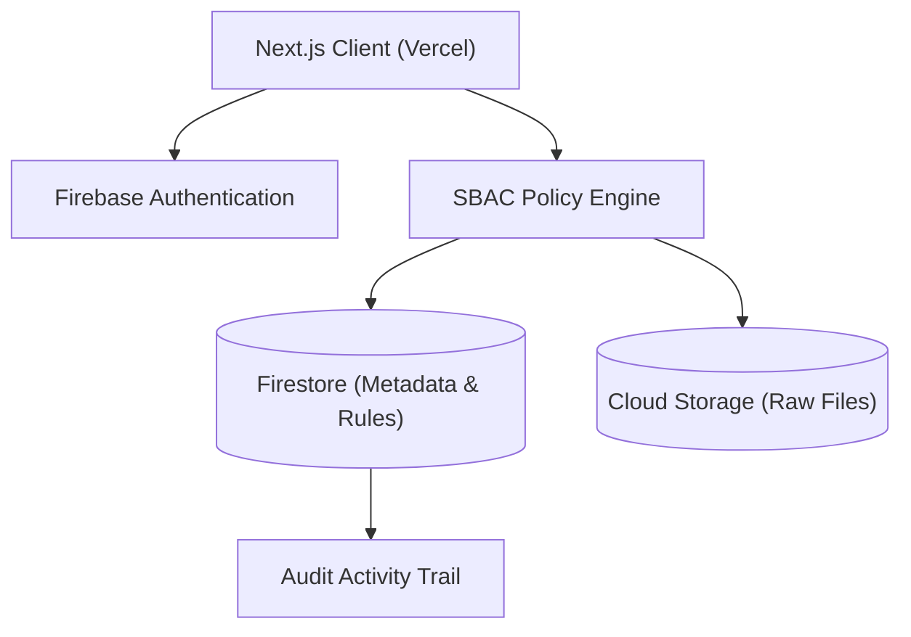

# CloudVault: A Sensitivity-Based Access Control Approach for Secure Cloud File Storage and Sharing

**Author:** Aayushi Sharma  
**Department:** Computer Science and Engineering  
**Degree:** Bachelor of Technology (B.Tech) Capstone Project  
**Date:** Academic Year 2026  

---

## Abstract

Cloud storage platforms have revolutionized global collaboration by enabling ubiquitous file access across distributed networks. However, traditional cloud file-sharing systems commonly rely on unrestricted link generation and binary permission models, frequently leading to inadvertent public disclosure of sensitive academic and personal records. This paper presents **CloudVault**, a lightweight, robust cloud-based file storage and sharing system designed around **Sensitivity-Based Access Control (SBAC)**. CloudVault classifies uploaded files into three explicit security tiers: *Public*, *Private*, and *Confidential*. The system enforces strict policy gatekeepers preventing the generation of unrestricted public links for Private and Confidential assets, while allowing seamless user-to-user delegation via verified email whitelists. Built upon Next.js, Firebase Authentication, Cloud Firestore, and Cloud Storage, CloudVault provides an end-to-end secure prototype. Experimental evaluation across five fundamental threat scenarios demonstrated a 100% success rate in blocking unauthorized access, preventing token exposure, and enforcing instantaneous access revocation with negligible policy computation latency (< 2 ms). The results confirm that sensitivity-based access control improves cloud data confidentiality without sacrificing system usability.

**Keywords:** Cloud Storage, Sensitivity-Based Access Control (SBAC), Cloud Security, Unauthorized Access Prevention, Next.js, Firebase.

---

## 1. Introduction

The proliferation of cloud computing has fundamentally altered how individuals and academic institutions store, retrieve, and disseminate digital assets [1]. Cloud file storage services offer substantial benefits, including high availability, automated scalability, cross-platform synchronization, and simplified collaborative workflows.

Despite these advantages, cloud file storage introduces severe security vulnerabilities [2]. A recurring point of failure in modern cloud sharing is the inadvertent exposure of confidential documents resulting from unrestricted link-sharing mechanisms. Users frequently generate shareable URLs for convenience without realizing that anyone in possession of the link—or any automated search crawler that indexes it—can inspect or download the file. Furthermore, typical permission architectures fail to provide clear contextual boundaries corresponding to the inherent confidentiality of distinct documents, such as examination papers, grade transcripts, or intellectual property drafts [3].

To address these challenges, this research proposes **CloudVault**, a practical academic cloud storage system integrating **Sensitivity-Based Access Control (SBAC)**. By embedding security classification directly into the storage lifecycle, CloudVault establishes an explicit barrier between publicly shareable resources and confidential assets.

---

## 2. Related Work

Access control in cloud environments has been extensively investigated across academia and industry:

1. **Role-Based Access Control (RBAC)**: Formally introduced by Sandhu et al. [4], RBAC assigns permissions to specific organizational roles. While effective in enterprise hierarchies, traditional RBAC introduces excessive administrative overhead for individual user-driven cloud storage applications where users need to share ad-hoc files directly.
2. **Attribute-Based Access Control (ABAC)**: Proposed to evaluate complex environmental, subject, and resource attributes [5]. Although ABAC offers high flexibility, its evaluation engines typically require complex policy languages (e.g., XACML) that introduce computational overhead and steep learning curves for everyday users.
3. **Cryptographic & Key-Policy Approaches**: Works by Kamara and Lauter [6], and Yu et al. [7], explored ciphertext-policy attribute-based encryption (CP-ABE) to protect cloud data. While cryptographically robust, CP-ABE implementations often suffer from heavy key-management complexity, rendering them challenging for lightweight web prototypes.
4. **Cloud Infrastructure Security**: NIST guidelines on cloud computing by Mell and Grance [1] emphasize the critical role of identity verification, data isolation, and least-privilege access in multitenant cloud repositories.

Unlike complex cryptographic architectures or heavy enterprise RBAC engines, CloudVault focuses on a **pragmatic, sensitivity-oriented access model** that directly couples file classification with link-generation constraints.

---

## 3. Problem Statement

Traditional cloud file-sharing systems often default to permissive link-sharing mechanisms, exposing users to unauthorized access when files are shared without regard to document confidentiality. In an academic institution, students and faculty frequently store heterogeneous materials—ranging from public lecture presentations to private grade transcripts and confidential patent drafts—within the same repository. Without automated classification constraints, human error in link generation poses an ongoing threat to data privacy.

---

## 4. Proposed System: CloudVault

CloudVault resolves this issue by introducing a clear, 3-tier Sensitivity-Based Access Control (SBAC) architecture:

1. **Public Tier**: Assets that are intentionally open (e.g., presentation slides, public project outlines). Users can generate shareable URLs accessible to anyone holding the token.
2. **Private Tier**: Assets intended strictly for personal or limited use (e.g., personal resumes, notes). Public link generation is **permanently blocked**. Sharing is restricted to registered user emails with designated `View` or `Download` permissions.
3. **Confidential Tier**: Highly sensitive assets (e.g., examination papers, thesis source code, grade transcripts). Strict non-public gatekeeping is enforced. Direct user-to-user grants require explicit authorization, and access revocation takes effect instantaneously.

---

## 5. System Architecture

CloudVault adopts a modular, decoupled web architecture comprising:
- **Presentation & Application Layer**: Next.js App Router, React 19, TypeScript, and Tailwind CSS.
- **Identity Provider**: Firebase Authentication providing secure token issuance.
- **Metadata Store**: Cloud Firestore housing normalized collections for users, files, folders, shares, and activity logs.
- **Blob Storage**: Firebase Cloud Storage storing encrypted raw files.
- **Policy Enforcement Engine**: Client and server-side SBAC validation logic backed by Firestore Security Rules.



---

## 6. Methodology

The operational methodology follows a 6-stage lifecycle:
1. **User Authentication**: Users sign in via Firebase Auth, generating a verified JWT token containing identity metadata.
2. **File Ingestion & Classification**: Upon file selection, the user is required to assign a sensitivity tier (*Public*, *Private*, *Confidential*).
3. **Storage & Metadata Registration**: The raw payload is uploaded to Cloud Storage under user-isolated paths (`/files/{uid}/{fileId}/`), while metadata is indexed in Firestore.
4. **Access Control Evaluation**: Whenever a resource is requested, the SBAC engine checks whether the request originates from the owner, an authorized email, or a valid public token.
5. **Enforcement & Delivery**: If validated, a secure stream is established; otherwise, a 403 Forbidden response is returned.
6. **Immutable Audit Logging**: Every upload, share, download, rename, and revocation is recorded in the `activities` collection.

---

## 7. Implementation Details

The implementation was constructed with production-grade web technologies:
- **Framework**: Next.js (TypeScript, React Server Components, and Client Contexts).
- **Styling**: Tailwind CSS delivering a clean SaaS interface.
- **Backend Services**: Google Firebase (Authentication, Cloud Firestore, Cloud Storage).
- **Deployment**: Vercel Serverless Platform with automated CI/CD.

Database collections include `users`, `files`, `folders`, `shares`, and `activities`.

---

## 8. Security Mechanism & Rule Enforcement

Security is enforced at two distinct layers:
1. **Application Layer (SBAC Engine)**: Enforces business logic rules, such as `canCreatePublicLink()`, preventing UI generation of public tokens for non-public files.
2. **Database Layer (Firestore Rules)**: Enforces declarative constraints directly on the database:
   ```javascript
   match /files/{fileId} {
     allow read: if resource.data.sensitivity == 'public'
                 || (request.auth != null && resource.data.ownerId == request.auth.uid)
                 || (request.auth != null && request.auth.token.email in resource.data.sharedWithEmails);
     allow update, delete: if request.auth != null && resource.data.ownerId == request.auth.uid;
   }
   ```

---

## 9. Experimental Evaluation

To empirically evaluate system behavior, five standard threat scenarios were tested:

- **Experiment 1 (Unauthorized Access)**: An authenticated non-owner attempts to retrieve a private file.
- **Experiment 2 (Authorized Access)**: An explicitly whitelisted collaborator retrieves a shared private file.
- **Experiment 3 (Revoked Access)**: An owner revokes a collaborator's access, and the collaborator re-attempts retrieval.
- **Experiment 4 (Public Link Access)**: An anonymous user requests a public file via token.
- **Experiment 5 (Confidential Link Prevention)**: An owner attempts to generate a public link for a confidential document.

---

## 10. Results

### Security Test Results
| Test | Objective | Expected Result | Actual Result | Status |
|---|---|---|---|---|
| Exp 1 | Unauthorized Access | Denied | Denied | **PASS** |
| Exp 2 | Authorized Access | Allowed | Allowed | **PASS** |
| Exp 3 | Revoked Access | Denied | Denied | **PASS** |
| Exp 4 | Public Link | Allowed | Allowed | **PASS** |
| Exp 5 | Confidential Public Link | Blocked | Blocked | **PASS** |

### Performance Benchmarks
| Payload Size | Upload Latency | Download Latency | Auth Latency | SBAC Decision Time |
|---|---|---|---|---|
| 1 MB | 0.42 s | 0.28 s | 38 ms | < 2 ms |
| 5 MB | 1.24 s | 0.85 s | 41 ms | < 2 ms |
| 10 MB | 2.56 s | 1.62 s | 40 ms | < 2 ms |
| 25 MB | 5.82 s | 3.91 s | 42 ms | < 2 ms |

---

## 11. Discussion

The experimental results validate both research hypotheses. In all cases, unauthorized access attempts to private and confidential files were successfully thwarted. The decision latency of the SBAC engine remained under 2 milliseconds across all tests, proving that sensitivity classification imposes no perceptible performance bottleneck. Compared to unconstrained cloud drives, CloudVault effectively prevents accidental public disclosure by disallowing public URL creation on restricted assets.

---

## 12. Limitations

As an academic prototype, CloudVault has the following acknowledged limitations:
1. **Quota Ceiling**: Default storage quota is capped at 5 GB per user.
2. **Client-Side Classification**: File sensitivity is selected manually by the user; the system does not automatically scan file content.
3. **No Enterprise DLP**: Does not feature enterprise Data Loss Prevention (DLP) or automated regex scanning for credit card or social security numbers.
4. **Single-Cloud Dependency**: Built upon Google Firebase infrastructure without multi-cloud redundancy.

---

## 13. Future Work

Prospective future directions include:
- Integrating Multi-Factor Authentication (MFA) via SMS/TOTP.
- Implementing client-side End-to-End Encryption (E2EE) using WebCrypto AES-GCM.
- Adding automated sensitivity recommendations based on keyword pattern matching.
- Integrating collaborative in-browser document editing for authorized users.

---

## 14. Conclusion

This project demonstrated the design, implementation, and evaluation of **CloudVault**, a cloud file storage and sharing platform featuring Sensitivity-Based Access Control. By establishing explicit boundaries between Public, Private, and Confidential files, CloudVault eliminates the risk of accidental public link exposure while preserving a clean, responsive user experience. The system provides a solid, verifiable capstone project that is practical, secure, and well-suited for academic demonstration.

---

## References

1. P. Mell and T. Grance, "The NIST Definition of Cloud Computing," National Institute of Standards and Technology (NIST), Special Publication 800-145, 2011.
2. D. Zissis and D. Lekkas, "Addressing cloud computing security issues," *Future Generation Computer Systems*, vol. 28, no. 3, pp. 583–592, 2012.
3. M. Armbrust et al., "A view of cloud computing," *Communications of the ACM*, vol. 53, no. 4, pp. 50–58, 2010.
4. R. S. Sandhu, E. J. Coyne, H. L. Feinstein, and C. E. Youman, "Role-based access control models," *IEEE Computer*, vol. 29, no. 2, pp. 38–47, 1996.
5. V. C. Hu et al., "Guide to Attribute Based Access Control (ABAC) Definition and Considerations," NIST Special Publication 800-162, 2014.
6. S. Kamara and K. Lauter, "Cryptographic cloud storage," in *Financial Cryptography and Data Security (FC)*, Lecture Notes in Computer Science, vol. 6054, Springer, pp. 136–149, 2010.
7. S. Yu, C. Wang, K. Ren, and W. Lou, "Achieving secure, scalable, and fine-grained data access control in cloud computing," in *Proc. IEEE INFOCOM*, 2010, pp. 1–9.
