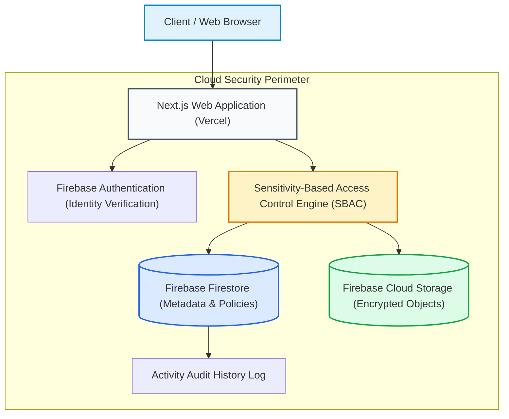
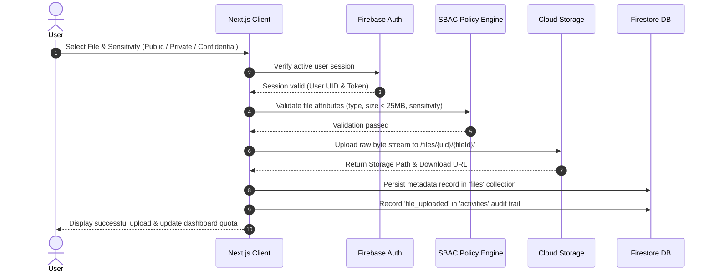
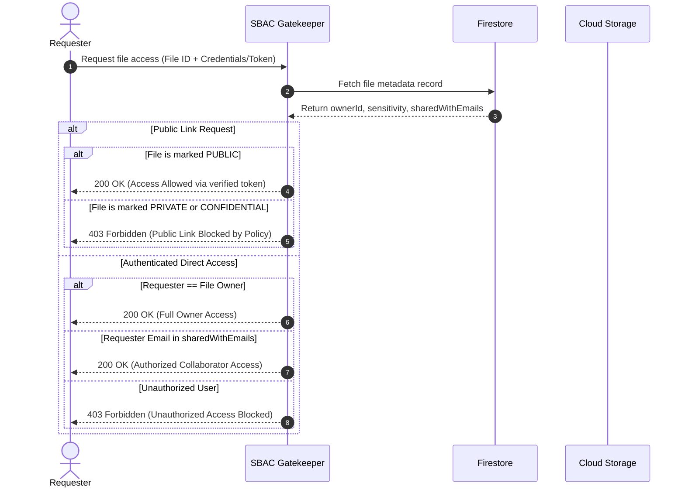
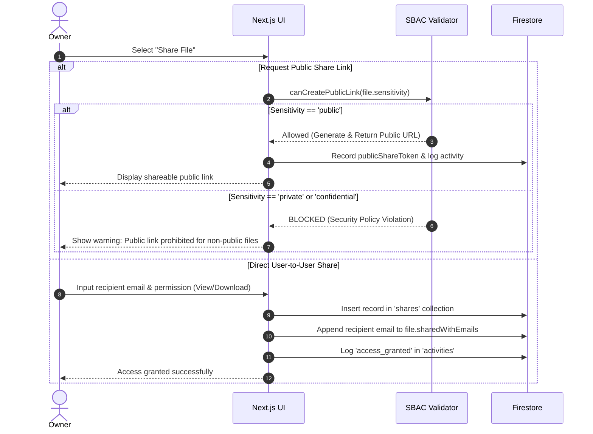
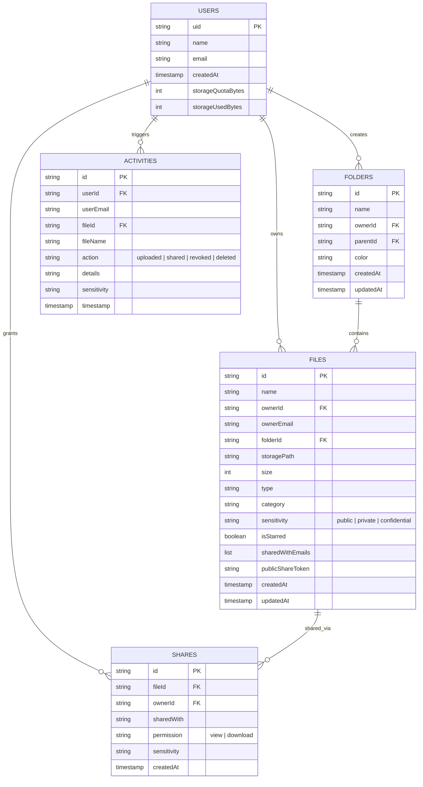

# CloudVault System Architecture

## 1. Overview

**CloudVault** is designed as a clean, reliable, and easily explainable cloud file storage and sharing platform built for academic and secure collaborative use.

The architecture strictly follows a decoupled cloud-native paradigm:
- **Presentation Layer**: Next.js (React 19, TypeScript, Tailwind CSS)
- **Identity & Authentication**: Firebase Authentication
- **Data & Metadata Layer**: Firebase Firestore
- **Blob Object Storage**: Firebase Cloud Storage
- **Policy Enforcement**: Sensitivity-Based Access Control (SBAC) Engine

---

## 2. High-Level Architecture Diagram

---

## 3. Core Operational Flows

### 3.1 File Upload & Classification Flow

---

### 3.2 File Access & Retrieval Flow (Enforcing SBAC)

---

### 3.3 File Sharing Flow

---

## 4. Firestore Database Schema

The database model is kept intentionally simple, normalized, and relational-friendly:

