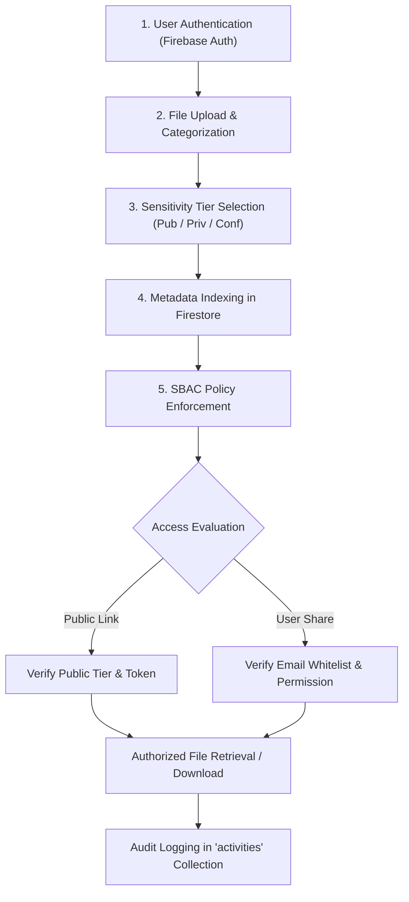

# Research Methodology & Experimental Design

## 1. Title & Academic Context

- **Project Title**: CloudVault: A Sensitivity-Based Access Control Approach for Secure Cloud File Storage and Sharing
- **Degree**: Bachelor of Technology (B.Tech) Final Year Capstone
- **Primary Domain**: Cloud Computing & Cyber-Security Engineering

---

## 2. Research Question & Hypotheses

### Research Question:
> *"How can sensitivity-based access control improve the security of cloud-based file sharing while maintaining usability?"*

### Hypotheses:
1. **Security Hypothesis ($H_1$)**: Enforcing explicit sensitivity classification at the point of file upload significantly reduces unauthorized access and accidental public disclosure of confidential files compared to traditional unrestricted link-sharing systems.
2. **Usability Hypothesis ($H_2$)**: A 3-tier sensitivity model (Public, Private, Confidential) provides adequate granularity for academic file sharing without adding measurable computational latency or cognitive complexity for end users.

---

## 3. Research Objectives

1. **System Development**: Design and build a simple, responsive cloud-based file storage and organization platform using Next.js and Firebase.
2. **Access Control Implementation**: Implement Sensitivity-Based Access Control (SBAC) spanning Public, Private, and Confidential tiers.
3. **Data Leakage Prevention**: Enforce hard policy barriers that prevent the generation of unrestricted public links for Private and Confidential assets.
4. **Security & Usability Evaluation**: Systematically conduct 5 security test cases and record latency benchmarks across variable payload sizes.
5. **Comparative Analysis**: Compare controlled sensitivity-based sharing with generic, unconstrained link-sharing models.

---

## 4. Methodology Workflow

---

## 5. Viva Presentation Slide Outline

For the B.Tech oral viva defense, students can structure their presentation as follows:
- **Slide 1**: Title, Candidate Details, Supervisor Information
- **Slide 2**: Introduction & Motivation (Rise of Cloud Storage & Accidental Leaks)
- **Slide 3**: Problem Statement & Research Question
- **Slide 4**: Objectives of the Project
- **Slide 5**: Proposed System — CloudVault Architecture
- **Slide 6**: Research Contribution: Sensitivity-Based Access Control (SBAC)
- **Slide 7**: Database Schema & Firebase Security Rules
- **Slide 8**: Experimental Evaluation (The 5 Viva Experiments)
- **Slide 9**: Performance Benchmarking Results (Upload/Download latencies)
- **Slide 10**: Comparative Security Table
- **Slide 11**: Limitations & Future Scope
- **Slide 12**: Conclusion & Live Demonstration
